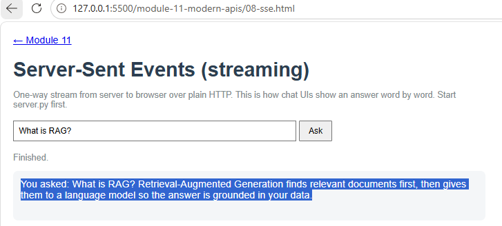
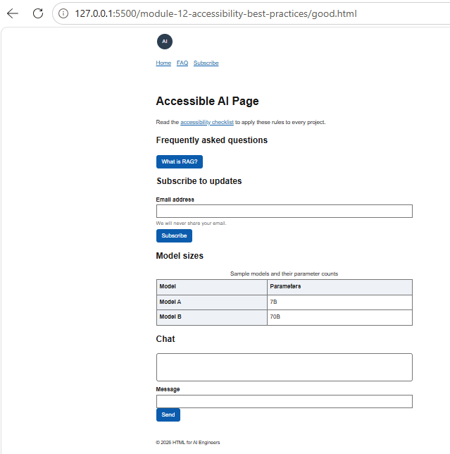
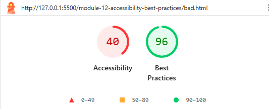
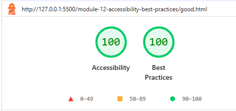

# HTML for AI Engineers

A module-by-module HTML learning project, focused on the HTML skills needed
to build interfaces for AI applications (chat windows, forms, streaming
responses, browser storage).

**Live site:** https://mohamedkalid-94.github.io/html-for-ai-engineers/

## Screenshots

| Streaming answer (Module 11, SSE) | Accessible chat page (Module 12) |
|---|---|
|  |  |

| Lighthouse: before | Lighthouse: after |
|---|---|
|  |  |

## Modules

| # | Module | Topics covered | Status |
|---|--------|----------------|--------|
| 01 | [Fundamentals](module-01-fundamentals/) | Headings, paragraphs, elements, attributes, formatting, quotations, comments, phrase and code elements | Done |
| 02 | [Structure](module-02-structure/) | Page skeleton, head element, meta tags, block vs inline, div/span, classes, IDs | Done |
| 03 | [Styling Basics](module-03-styling-basics/) | Inline, internal and external CSS, fonts, color formats (name, RGB, HEX, HSL), backgrounds | Done |
| 04 | [Images & Media](module-04-images-media/) | Images, image maps, iframes, video, audio, embed, inline SVG, canvas | Done |
| 05 | [Links & Navigation](module-05-links-navigation/) | Text, image and email links | Done |
| 06 | [Tables](module-06-tables/) | Headers, captions, styling, colgroup, nesting | Done |
| 07 | [Lists](module-07-lists/) | Unordered, ordered, definition lists | Done |
| 08 | [Forms](module-08-forms/) | Form attributes, controls, input attributes | Done |
| 09 | [Layout & Responsive](module-09-layout-responsive/) | Layout elements, CSS layout, responsiveness, symbols, emojis | Done |
| 10 | [JavaScript Integration](module-10-javascript-integration/) | JavaScript in HTML, DOM | Done |
| 11 | [Modern HTML APIs](module-11-modern-apis/) | Geolocation, drag and drop, web workers, WebSocket, web storage, SSE, IndexedDB, CORS, WebRTC | Done |
| 12 | [Accessibility & Best Practices](module-12-accessibility-best-practices/) | Style guide, validation | Done |

## Project structure

```
html-for-ai-engineers/
├── index.html                  # landing page linking to every module
├── README.md
├── .gitignore
├── docs/
│   └── screenshots/            # images used in this README
├── module-01-fundamentals/
│   └── index.html
├── module-02-structure/
│   └── index.html
├── module-03-styling-basics/
│   ├── index.html
│   └── style.css
├── module-04-images-media/
│   ├── index.html
│   ├── images/
│   └── media/
├── module-05-links-navigation/
│   ├── index.html
│   ├── about.html
│   ├── pages/
│   └── images/
├── module-06-tables/
│   └── index.html
├── module-07-lists/
│   └── index.html
├── module-08-forms/
│   └── index.html
├── module-09-layout-responsive/
│   └── index.html
├── module-10-javascript-integration/
│   ├── index.html
│   └── script.js
├── module-11-modern-apis/
│   ├── index.html
│   ├── style.css
│   ├── 01-geolocation.html ... 10-webrtc.html
│   ├── worker.js
│   ├── child.html
│   └── server/
│       ├── server.py
│       └── requirements.txt
└── module-12-accessibility-best-practices/
    ├── bad.html
    ├── good.html
    └── CHECKLIST.md
```

## How to run locally

1. Clone the repository:
   ```bash
   git clone https://github.com/MohamedKalid-94/html-for-ai-engineers.git
   ```
2. Open the folder in VS Code.
3. Install the **Live Server** extension.
4. Right-click any module's `index.html` and choose **Open with Live Server**.

Alternative without an extension (run from the repo root):

```bash
python -m http.server 8000
```

Then open `http://localhost:8000`.

## Running the Module 11 server

Demos 07 (WebSocket), 08 (Server-Sent Events) and 09 (CORS) need a small
FastAPI backend. The static pages themselves work without it.

```bash
cd module-11-modern-apis/server
pip install -r requirements.txt
uvicorn server:app --reload --port 8000
```

Then open the demo pages through Live Server (`http://127.0.0.1:5500` or
`http://localhost:5500`). Those are the origins the server allows.

| URL | What it does |
|---|---|
| `http://127.0.0.1:8000/api/hello` | JSON response used by the CORS demo |
| `http://127.0.0.1:8000/stream?prompt=test` | Streams an answer word by word (SSE) |
| `ws://localhost:8000/ws` | WebSocket echo endpoint |
| `http://127.0.0.1:8000/docs` | Automatic API documentation |

To see a CORS error on purpose, start the server with `ALLOW_CORS=0`
(PowerShell: `$env:ALLOW_CORS="0"; uvicorn server:app --port 8000`).

## Module 12: before and after

`bad.html` is a deliberately broken page, and `good.html` is the corrected
accessible version. Both were checked with the W3C Markup Validator and
Chrome Lighthouse.

| Check | `bad.html` | `good.html` |
|---|---|---|
| W3C validator errors | 8 | 0 |
| Lighthouse Accessibility | 40 | 100 |
| Lighthouse Best Practices | 96 | 100 |
| Keyboard only navigation | Fails (fake button, no labels) | Passes (skip link, visible focus) |
| Text contrast | About 1.6:1 | 4.5:1 or higher |

The reusable checklist is in
[`CHECKLIST.md`](module-12-accessibility-best-practices/CHECKLIST.md).

## Learning approach

- One folder per module, each runnable on its own
- Every module includes code, an explanation, a tags/properties reference,
  the expected result and practice exercises
- Committed after each module, so the Git history shows progress

## Notes

- Modules 01 to 10 and 12 run as plain static pages on  Pages.
- In Module 11, demos 07 to 09 need the FastAPI server running locally on port 8000.

## What I learned

HTML fundamentals, structure, styling basics, media, links, tables, lists, forms,
responsive layout, JavaScript and the DOM, modern browser APIs, accessibility and validation.

## Author

**Mohamed Kalid**

Embedded systems engineer (8 years) moving into AI engineering.